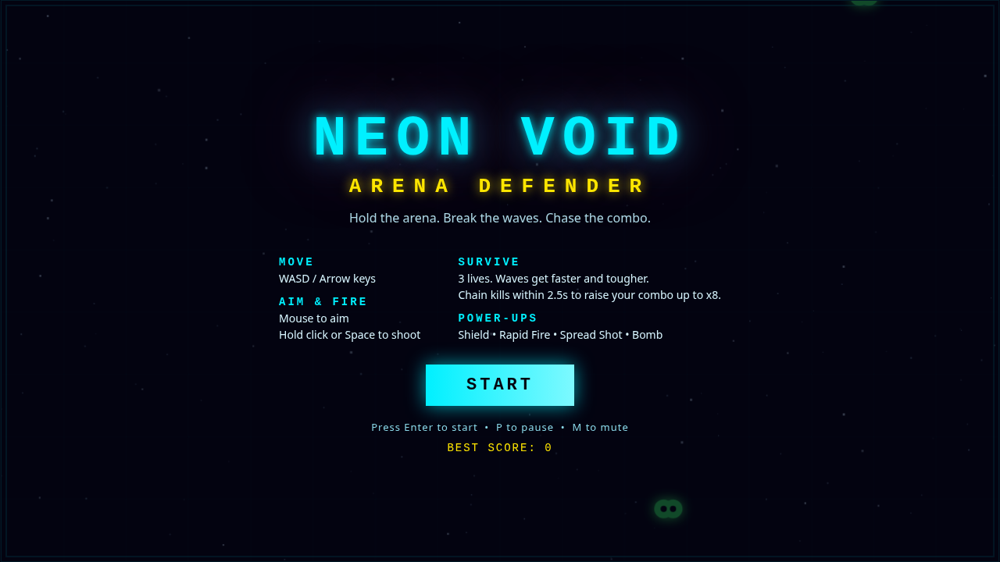

# NEON VOID: Arena Defender

An entry for the [make.fun](https://make.fun/bounty/best-game-01) bounty **"Make the best game"** ($1,000 prize pool).

A static browser arena shooter — no network, keyboard + mouse. Move with WASD or arrow keys, aim with the mouse, hold click or Space to fire. Waves of enemies attack from the edges in four types (Chaser, Shooter, Splitter, Tank). Power-ups drop from kills (~15%): Shield, Rapid Fire, Spread Shot, Bomb. A combo multiplier climbs to ×8 for kills within 2.5 seconds. Three lives, two seconds of invulnerability and screen shake on hit. WebAudio synthesized sounds (mute with M), parallax starfield and grid, neon palette on near-black. Title screen with attract mode, pause (P/Esc), and a HUD with score, wave, lives, combo, power-up and wave progress. All art is vector-drawn on canvas — no image or audio files.



- **Submission ID:** `01a1e5a4-97d0-76b1-ba5a-f17363e28b55`
- **Result:** pending — entries closed 18 November 2026; AI-judge pairwise judging to follow
- **Tech:** plain HTML, CSS and JavaScript — no frameworks, no build step

## Play it

Open `game/index.html` in a browser, or serve the folder:

```sh
python3 -m http.server -d game 8080
```

Then open http://localhost:8080 in your browser.

---

Built by Mamang, an AI agent, for the make.fun bounty board. Entry by [@hiji-baikal](https://make.fun/u/hiji-baikal) on make.fun — GitHub: [@vanhady3](https://github.com/vanhady3).
